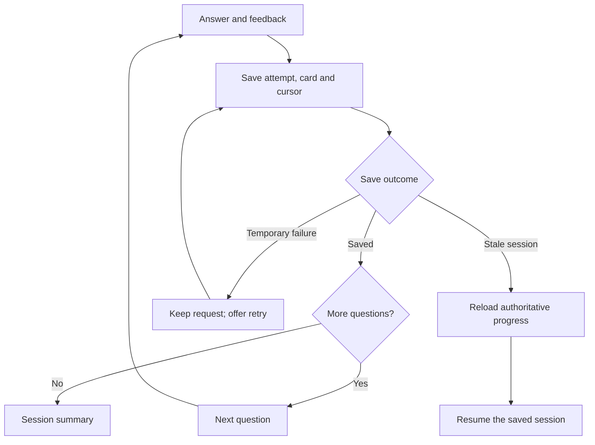

# Planned product flows and agent workflow

Product flows in this document describe the application that will be implemented. The starter does not include their screens, data or services. [REQUIREMENTS.md](REQUIREMENTS.md) will own product behavior, [SDD.md](SDD.md) will own technical boundaries, and [PROGRESS.md](PROGRESS.md) will be the only implementation status and handoff record.

## 1. First visit and onboarding

The product will require sign-in with a pre-created account. A new authenticated learner will enter a short, focused onboarding flow:

| Step              | Choice                                                    | Skip/default behavior                                    |
| ----------------- | --------------------------------------------------------- | -------------------------------------------------------- |
| 1. Daily time     | Choose a practical learning target                        | 10 minutes                                               |
| 2. New senses     | Choose how many new meanings/phrases to introduce per day | 8 new senses per day                                     |
| 3. Starting topic | Choose from real reviewed catalog topics                  | First editorially recommended available foundation topic |

Back will preserve the local draft. Each step will offer Skip, applying that step's default while preserving earlier choices. Finishing or skipping the final step will save only `dailyMinutes`, `newPerDay` and a minimal onboarding-completed marker, then open Today with a clear start action. The chosen/default topic draft will be passed into the first `SessionConfig`; it will not become a persistent topic preference. Other settings will remain unchanged. If the settings save fails, the draft will remain available and onboarding will not be falsely marked complete. An empty catalog will show a content-availability state; it will not invent a topic. No long questionnaire or mandatory placement test will block entry.

The default/fallback interface locale will be English (`en`), the default timezone will be `Asia/Ho_Chi_Minh`, and Settings will allow each to change independently; Vietnamese (`vi`) is the other initial UI locale. Audio will start with an available English voice and rate `0.9`. These will not add extra onboarding steps. Once onboarding has been saved, returning visits will go to Today with a start/resume action.

## 2. Navigation and learning entry points

Today, Learn, Practice, Library and Progress will be the five desktop pill tabs and the five mobile bottom-navigation destinations. Settings will be separate. All screens will follow the bright Brilliant-inspired design direction; sessions and onboarding will use focused layouts.

Every flow state uses the shared i18n layer, including validation, loading, empty, save, conflict and accessibility messages. Switching locale changes UI copy and locale-aware formatting without changing the current route/session, timezone, speech voice, learning content or Vietnamese-gloss evidence.

- **Today** will offer one primary action: resume a saved session, or start a recommended daily session.
- **Learn** will recommend a path while allowing the learner to choose another lesson/topic. Opening a later lesson will not grant mastery for skipped material.
- **Practice** will offer presets and a small custom configuration; each will produce the same session config model.
- **Library** will support search, filters, definitions/examples, audio, bookmarks and selecting senses for practice. Browsing/listening/bookmarking alone will not create an attempt.
- **Progress** will show committed activity and clearly named metrics, with empty states for insufficient evidence.

Choosing a new session while another is current will offer resume or a clearly described replacement. Replacing it will preserve previously saved answers. There will be no silent creation of competing active sessions.

## 3. A learning session

The application will load saved progress and reviewed content, build a bounded queue, and save a new session before showing the first question. Daily sessions will mix due, new and weak senses within the configured limits. A first encounter will introduce meaning in context before demanding recall.

The learner will answer through one of the five exercise interactions. Optional English hints and Vietnamese glosses will remain available as appropriate; the attempt will record their use. Feedback will explain the answer immediately. The same answer request will then remain available until it is saved or explicitly abandoned.

The next question will be available after a successful save. An ambiguous network response will trigger a retry with the same attempt ID and payload. The server will recognize an already committed request before fresh-session revision checks, so its retry will remain successful after the cursor advances. A fresh stale-session response will offer reload instead of repeatedly sending a conflicting request. The UI will distinguish "Saving", "Saved" and "Not saved". Closing the tab with an unsaved answer will not be promised to recover that answer in the initial MVP.

On a mistake, the original attempt will remain in history. Feedback will lead to a bounded retry after intervening questions where possible, preferably with another reviewed context. Immediate success after explanation will count as practice, not new independent-recall evidence. A finite retry budget will let the learner finish the session rather than become trapped in a loop.

The summary will describe the actual completed session and offer an appropriate next action. Session completion, lesson completion and long-term mastery will remain distinct.

## 4. Practice and availability rules

Every entry point will reuse the same renderer, grading rules, audio boundary and save flow. A preset will select configuration, not fork the engine.

| Situation                                          | Planned behavior                                                                                  |
| -------------------------------------------------- | ------------------------------------------------------------------------------------------------- |
| No due cards                                       | Explain that nothing is due; let the learner choose another mode.                                 |
| A topic/kind/sense filter has no matching exercise | Show an empty state and an option to change the filter; do not silently broaden it.               |
| Daily new-sense budget is exhausted                | Explain the remaining review/practice choices without introducing additional new senses silently. |
| Audio is unavailable                               | Keep text exercises usable and offer a different available voice where possible.                  |
| A bookmark update fails                            | Keep the last confirmed state and provide retry feedback.                                         |
| A different account signs in                       | Remove the previous account's private state before loading the next account.                      |

## 5. Agent implementation flow

The working loop will be:

**Take a task → inspect requirements, SDD and relevant design → implement the smallest useful slice → verify the affected behavior → review/refactor where useful → typecheck and lint before a code commit → update PROGRESS.**

1. Read `AGENTS.md`, the assigned task and the current handoff in [PROGRESS.md](PROGRESS.md). Use [PLAN.md](PLAN.md) to open the detailed phase file. Do not create another task/status board.
2. Read only the relevant requirement and SDD sections plus existing code. For UI work, also read the design rules and any user-added boards in `docs/design/` that actually exist. Reuse an existing component or flow when it already solves the problem.
3. Choose a small implementation that reaches the task's observable outcome. Add a short local plan only when dependencies or uncertainty warrant it. Resolve ordinary reversible details without asking for repeated approval.
4. Verify the concrete risk introduced by the change. Use the smallest meaningful check; keep successful evidence unless a later relevant edit invalidates it.
5. Review the diff for correctness, duplication, naming and scope. Refactor the changed area when it makes the change clearer; do not manufacture an unrelated cleanup task.
6. Before committing changed code, run typecheck and lint on the final code state through the project's check command. A production build will be useful for initial delivery, dependency/build changes or release packaging; it will not be mandatory after every copy edit.
7. Update [PROGRESS.md](PROGRESS.md) with the task outcome, actual checks and their scope, any real blocker, and the next useful action. Link the phase task instead of copying its entire specification.

### Choose verification by risk

| Change                                     | Proportionate verification                                                                                             |
| ------------------------------------------ | ---------------------------------------------------------------------------------------------------------------------- |
| Documentation only                         | Read the diff, resolve contradictions and check touched links; no npm run is necessary.                                |
| Copy, spacing or a small visual adjustment | Inspect the changed screen and relevant viewport; no unit test for static text or CSS values.                          |
| New exercise/session behavior              | Check the actual interaction; add focused tests for rules with meaningful failure modes.                               |
| Auth, RLS or atomic persistence            | Verify affected allow/deny, duplicate, stale-write or rollback behavior against the relevant database/API environment. |
| Scheduler integration                      | Check the application's eligibility/grade mapping and serialization, without re-testing library arithmetic.            |
| Audio provider                             | Check actual playback/cancellation and the affected fallback path.                                                     |

The starter will not preinstall a test runner, browser test suite or test scripts. The first task with a meaningful automated failure case will add the smallest suitable tool. There will be no coverage percentage quota, mandatory test per function, snapshot suite for every component, or full gate run after every edit. A persistence idempotency test will protect stored effects; testing that two generated IDs differ will not prove that property.

### Parallel work and handoff

Multiple agents will be useful only when their work can be separated by concrete files or contracts. The coordinator will assign ownership and communicate shared shapes before edits. Agents will report changed files, behavior, verification and limitations; the integrator will inspect the connecting behavior. A standing chain of reviewers, approvals or repeated full-suite runs will not be required.

Work that changes accepted requirements, removes important user data or performs an unrequested external deployment will need the relevant decision before that action. Routine implementation and reversible fixes within the assigned scope will proceed. If a dependency or access gap blocks only one part, the agent will finish the independent useful work and record the narrow blocker.

Specification documents will explain what to build. Phase files will contain detailed tasks and acceptance conditions. [PROGRESS.md](PROGRESS.md) alone will say what is active, completed or handed off. References to planned modules in these documents will never be used as evidence that those modules exist.
